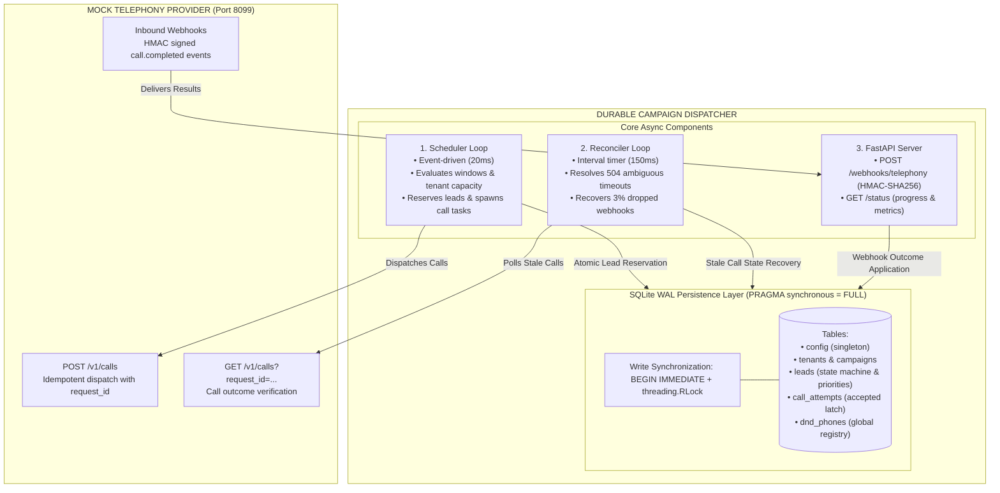
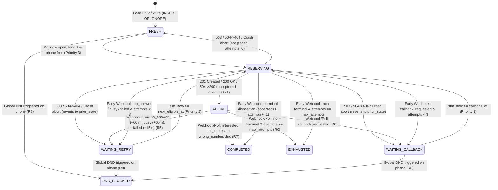

# Submission: Durable Campaign Dispatcher (Assignment B)

## Overview
- **Assignment:** B — Durable Campaign Dispatcher (Workflow)
- **Stack & Runtime:** Python 3.12+, FastAPI, Uvicorn, HTTPX, SQLite 3 (`WAL` Mode), Pytest
- **Test Coverage:** 68 deterministic unit/integration tests + automated `SIGKILL` (`kill -9`) chaos harness

---

## 1. How to Run & Verify

All commands below can be run from `assignment-b-workflow/` (or from the repository root by prefixing paths with `assignment-b-workflow/`).

### 1.1 Environment Setup
```bash
python3 -m venv .venv
source .venv/bin/activate
pip install -r requirements.txt
```

### 1.2 Run Unit & Integration Tests (Fake Clock — Sub-Second)
All window math, retry/callback calculations, priority ordering, SQLite atomic state transitions, and webhook/client behaviors are tested deterministically using `FakeClock` without waiting on the mock carrier:
```bash
cd assignment-b-workflow
pytest tests -v
```

### 1.3 Run End-to-End Manually
**Terminal 1 — Start the Mock Telephony Provider:**
```bash
cd assignment-b-workflow
python -m mock_telephony --speed 600 --seed 7 --failure-scale 1.0 --port 8099
```

**Terminal 2 — Run the Durable Dispatcher:**
```bash
cd assignment-b-workflow
rm -f dispatcher.db dispatcher.db-wal dispatcher.db-shm final_state.csv
python -m dispatcher \
  --fixtures fixtures/campaigns.json \
  --db dispatcher.db \
  --output final_state.csv \
  --provider-url http://127.0.0.1:8099 \
  --host 127.0.0.1 \
  --port 8200
```
* While running, query `GET http://127.0.0.1:8200/status` to inspect live progress per campaign, active tenant concurrency, and the simulated clock.
* Once all 200 leads reach a final state, the service atomically writes `final_state.csv` and exits with code `0`.

### 1.4 Run Automated Chaos & `kill -9` Verification Harness
`scripts/verify_chaos.py` boots `mock_telephony` (`--speed 1200 --failure-scale 1.0`), starts the dispatcher, injects 3 rounds of hard `SIGKILL` (`kill -9`) while calls are actively in flight, restarts the process against the surviving SQLite WAL database, and verifies `violation_count == 0` and a 100% row-for-row match between `final_state.csv` and `GET /admin/leads`:
```bash
cd assignment-b-workflow
python scripts/verify_chaos.py --seed 42 --speed 1200 --crashes 3
```

---

## 2. System Architecture & Persistence Choice



### 2.1 Codebase Layout (`dispatcher/`)
- **`models.py`:** Domain dataclasses (`GlobalConfig`, `Tenant`, `Campaign`, `Lead`, `CallAttempt`, `DndPhone`) and strict state enums (`LeadState`, `AttemptState`).
- **`clock.py`:** IST (`UTC+05:30`) timestamp parsing/formatting, `SimClock` (computes `sim_epoch + (time.time() - real_epoch) * speed` locally without polling overhead), and `FakeClock` for unit tests.
- **`rules.py`:** Pure, stateless scheduling and compliance logic (`R1`, `R4`–`R9`). Zero SQL and zero HTTP dependencies.
- **`db.py`, `io_files.py`, `transitions.py`:** SQLite connection management (`journal_mode=WAL`, `synchronous=FULL`, `foreign_keys=ON`, `busy_timeout=5000`), serialized `BEGIN IMMEDIATE` write transactions guarded by a re-entrant thread lock (`threading.RLock`), idempotent fixture loading, atomic state transitions, and crash-safe CSV export.
- **`client.py`:** Typed `httpx.AsyncClient` wrapper mapping carrier responses into domain results (`CallAccepted`, `CallTransientError`, `CallAmbiguousError`, `CallRejectedError`, `CallFound`, `CallNotFound`).
- **`engine.py`:** Orchestrates `startup_recover()`, the non-blocking `scheduler_loop()`, and the background `reconciler_loop()`.
- **`app.py` & `__main__.py`:** FastAPI webhook receiver (`POST /webhooks/telephony`), observability endpoint (`GET /status`), and CLI lifecycle runner.

### 2.2 Why SQLite (WAL Mode) Over Temporal?
1. **Strict Serialization of Cross-Campaign Invariants (`R2` & `R3`):** Tenant concurrency limits apply across *all* campaigns owned by a tenant (`R2`), and phone number exclusivity applies across *all* campaigns globally (`R3`). In SQLite, executing reservation checks inside `BEGIN IMMEDIATE` serializes writers at the database engine level, guaranteeing that two concurrent tasks can never over-allocate a tenant slot or double-dial a shared phone number.
2. **Sub-Millisecond Reaction to a 600×–1200× Clock:** At 1200× speed, 1 real second equals 20 simulated minutes. Temporal's timer polling and activity task queues introduce multi-hundred-millisecond scheduling overhead that inflates `callback_lateness_minutes`. An embedded SQLite query paired with an `asyncio.Event` wakeup reacts in `< 1ms` real time whenever a slot opens.
3. **Zero External Process Desynchronization on `kill -9`:** With `PRAGMA journal_mode = WAL` and `PRAGMA synchronous = FULL`, every state transition is durably committed to disk before any network packet leaves the process.
4. **Trade-off:** SQLite is single-writer on a local filesystem. Moving to multi-node horizontal scale requires PostgreSQL (`FOR UPDATE SKIP LOCKED`) and distributed concurrency counters (detailed in Section 6).

---

## 3. Lead Lifecycle State Machine

Every `(campaign_id, lead_id)` progresses through 8 deterministic states. Because a simulated call can fail in 3–10 simulated seconds (`5–16ms` real time at 600× speed) and post-accept `504` responses sleep for `2.0` real seconds before returning, webhooks frequently arrive while a lead is still in `RESERVING`. Our state machine explicitly supports direct transitions from `RESERVING` to post-call states.



---

## 4. Failure Modes, Race Conditions & Compliance Guarantees

| Failure Mode / Rule | Underlying Trap | How Our Design Guarantees Safety |
| :--- | :--- | :--- |
| **Crash (`kill -9`) between deciding to dial and HTTP POST** | Dialing before DB commit causes double-dial on restart; committing `ACTIVE` before HTTP POST leaks capacity if killed before the request leaves. | **Write-Ahead Reservation (`RESERVING`):** Before calling `POST /v1/calls`, `reserve_next_lead()` atomically increments `dispatch_seq`, writes `request_id = "{cid}:{lid}:seq_{seq}"`, and sets `state = 'RESERVING'`. Both `RESERVING` and `ACTIVE` count toward tenant concurrency (`R2`) and phone locks (`R3`). On restart, `startup_recover()` queries `GET /v1/calls?request_id=...` before scheduling new calls: `404` aborts and reverts to `prior_state` (`attempts` unchanged); `200` recovers the active or ended call. |
| **Ambiguous `504` timeouts (pre-accept vs. post-accept)** | In `mock_telephony/server.py`, 2% of calls return `504` *before* acceptance and 4% return `504` *after* accepting the call and sleeping `2.0s`. | `CarrierClient` maps `504` and network timeouts to `CallAmbiguousError`. `_dispatch_attempt()` immediately runs `_reconcile_attempt()`, querying `GET /v1/calls?request_id=...`. A `404` safely aborts the reservation; a `200` transitions the call to `ACTIVE` or applies its `ended` result. |
| **Webhook arrives *before* `201` or `504` response** | During a `2.0s` post-accept `504` sleep (or a `5ms` failed call), the webhook arrives while `POST /v1/calls` is still awaiting response headers. | `call_attempts` has an integer latch `accepted (0 -> 1)`. When an early webhook arrives while the attempt is still `RESERVING`, `apply_call_outcome()` sees `accepted == 0`, increments `leads.attempts` by 1, sets `accepted = 1`, and marks the attempt `ENDED`. When `201` or `504` later returns, `mark_attempt_accepted()` sees `state == 'ENDED'` and exits as a safe no-op. |
| **High-speed reconciler vs. in-flight POST race (`--speed 1200`)** | At 1200× speed, 15 simulated seconds is `12.5ms` real time. A background poller could query `GET /v1/calls` before an in-flight `POST /v1/calls` reaches the carrier, see `404`, and abort a live request. | `DispatcherEngine` tracks `active_dispatch_ids` in memory for coroutines actively awaiting `POST /v1/calls`. `reconciler_loop()` skips `RESERVING` attempts while their coroutine is alive, whereas `startup_recover()` reconciles all orphaned `RESERVING` rows after a `kill -9` restart. |
| **Duplicate webhooks (10% rate) & forged requests** | Processing a duplicate webhook can double-increment attempts or overwrite newer state. | `POST /webhooks/telephony` verifies `X-AU-Signature` over the raw request body using `hmac.compare_digest` (`401` on failure). `apply_call_outcome()` checks `attempt.state in (ENDED, ABORTED)` inside `BEGIN IMMEDIATE` and returns `False` on duplicates. |
| **Dropped webhooks (3% loss rate)** | Silently lost webhooks leave calls in `ACTIVE` forever, starving tenant concurrency slots. | `reconciler_loop()` runs every `150ms` real time, polling `GET /v1/calls?request_id=...` for any `ACTIVE` call older than `60` simulated seconds and feeding completed payloads into `apply_call_outcome()`. |
| **Window boundary clock skew (`R1`)** | Network delay at `20:59:59` could cause `POST /v1/calls` to land after `21:00:00`. | `effective_daily_bounds()` intersects the campaign window with the `09:00–21:00 IST` regulatory window. `is_window_open()` and `next_valid_window_open()` apply a **15 simulated-second close buffer** (`DEFAULT_CLOSE_BUFFER_SEC = 15`) so no new calls are initiated in the final 15 simulated seconds of any window. |
| **Global DND & final state precedence (`R8`, `R9`)** | A phone appearing in multiple campaigns must be blocked globally on `dnd` without overwriting a lead that already `completed` or `exhausted`. | On `disposition == "dnd"`, the dialed lead becomes `COMPLETED`, the phone is recorded in `dnd_phones`, and a single SQL `UPDATE` transitions other leads with that phone to `DND_BLOCKED` **only** where `state NOT IN ('COMPLETED', 'EXHAUSTED', 'DND_BLOCKED', 'RESERVING', 'ACTIVE')`, preserving `completed > exhausted > dnd_blocked` and retaining prior `attempts`/`last_status`. |

---

## 5. Key Engineering Decisions

| Decision | Rationale | Alternative Rejected |
| :--- | :--- | :--- |
| **Monotonic `dispatch_seq` per lead** | Generates human-readable, deterministic keys (`{campaign_id}:{lead_id}:seq_{n}`). When a `503` or `504 -> 404` aborts an attempt, incrementing `dispatch_seq` gives the retry a fresh key without colliding in `call_attempts`. | Random UUIDs (harder to trace across logs) or keying by `attempt_no` alone (collides after a `503`). |
| **Non-blocking per-call dispatch tasks** | `scheduler_loop` reserves eligible leads synchronously in SQLite and spawns an `asyncio.Task` per HTTP call. A 2-second `504` stall on Tenant A never blocks Tenant B from dialing. | Sequential `await place_call()` inside the scheduler loop (stalls all tenants on a single slow carrier request). |
| **Port-ready barrier before recovery** | `__main__.py` waits until `uvicorn.Server.started` is `True` on port `8200` *before* running `startup_recover()` and `scheduler_loop()`, guaranteeing fast webhooks never hit a closed socket. | Starting background loops via FastAPI startup tasks before the socket is bound. |
| **Atomic POSIX CSV export** | `export_final_state_csv()` writes to a hidden sibling temp file, calls `flush()` + `os.fsync()`, and swaps via `os.replace()` only after `count_non_final_leads() == 0`. | Opening `final_state.csv` directly with `"w"` (risks truncated output if killed mid-write). |

---

## 6. What Changes at 1M Leads/Day Across 50 Tenants

Scaling from 200 leads to **1,000,000 leads/day across 50 tenants** (~35–50 calls/sec sustained at peak hours across horizontally scaled workers) requires four architectural shifts:

1. **Partitioned PostgreSQL with `SKIP LOCKED`:**
   - Replace single-file SQLite with **PostgreSQL**, partitioning `leads` and `call_attempts` by `tenant_id`.
   - Multiple stateless scheduler workers claim batches of due leads concurrently via:
     ```sql
     SELECT * FROM leads
     WHERE tenant_id = $1
       AND state IN ('WAITING_CALLBACK', 'WAITING_RETRY', 'FRESH')
       AND (next_eligible_at IS NULL OR next_eligible_at <= $2)
     ORDER BY priority ASC, next_eligible_at ASC
     LIMIT 50
     FOR UPDATE SKIP LOCKED;
     ```
2. **Distributed Concurrency & Phone Semaphores in Redis:**
   - Replace SQL `COUNT(*)` checks with a single **Redis Lua script** that atomically checks and increments `tenant_active:{tenant_id}` against `max_concurrent_calls` and acquires a distributed lock `phone_lock:{phone}` (with a TTL lease renewed or released on webhook completion).
3. **Indexed Delay Queues Instead of Table Scans:**
   - Maintain per-tenant **Redis Sorted Sets (`ZSET`)** scored by `next_eligible_at` epoch timestamps so due callbacks and retries are popped in $O(\log N)$ time, ensuring fair tenant scheduling so a 100k-lead bulk upload for Tenant A never delays a due callback for Tenant B.
4. **Decoupled Webhook Ingress:**
   - Run stateless FastAPI webhook receivers behind an ALB that verify `X-AU-Signature`, write raw events to **Kafka / RabbitMQ** keyed by `(campaign_id, lead_id)`, and return `200 OK` in `< 2ms`, insulating carrier webhooks from database write spikes.

---

## 7. Verification Output (`scripts/verify_chaos.py`)

```text
======================================================================
ASSIGNMENT B: AUTOMATED CHAOS & CRASH VERIFICATION HARNESS
======================================================================
[1/5] Starting mock telephony server on port 8099 (speed=1200.0x, seed=42, failure=1.0)...
      Mock telephony server is healthy and responding.
[2/5] Commencing 3 rounds of hard kill -9 crash injection...
      [Round 1/3] Spawning dispatcher (PID will be killed mid-flight)...
      [Round 1/3] Injecting SIGKILL (kill -9) to PID 34!
      [Round 1/3] Process killed. SQLite WAL preserved on disk.
      [Round 2/3] Spawning dispatcher (PID will be killed mid-flight)...
      [Round 2/3] Injecting SIGKILL (kill -9) to PID 49!
      [Round 2/3] Process killed. SQLite WAL preserved on disk.
      [Round 3/3] Spawning dispatcher (PID will be killed mid-flight)...
      [Round 3/3] Injecting SIGKILL (kill -9) to PID 59!
      [Round 3/3] Process killed. SQLite WAL preserved on disk.
[3/5] Starting final dispatcher instance to resume from surviving SQLite WAL...
      Dispatcher running as PID 70. Waiting for all 200 leads to complete...
      Dispatcher exited with code 0.
[4/5] Evaluating provider admin report...
      Total calls placed: 408
      Active calls:       0
      Violations:         0
      Webhook stats:      {'delivered': 428, 'duplicates': 33, 'connect_errors': 19, 'lost': 13}
      PASS: 0 violations, 0 stranded active calls.
[5/5] Performing exact 1:1 diff between final_state.csv and /admin/leads...
      PASS: All 200 leads match expected provider outcomes identically (100% diff accuracy).
======================================================================
SUCCESS: ALL CHAOS & CRASH VERIFICATION CHECKS PASSED WITH 0 VIOLATIONS!
======================================================================
```
